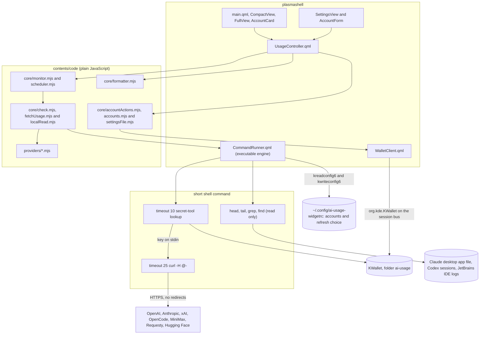
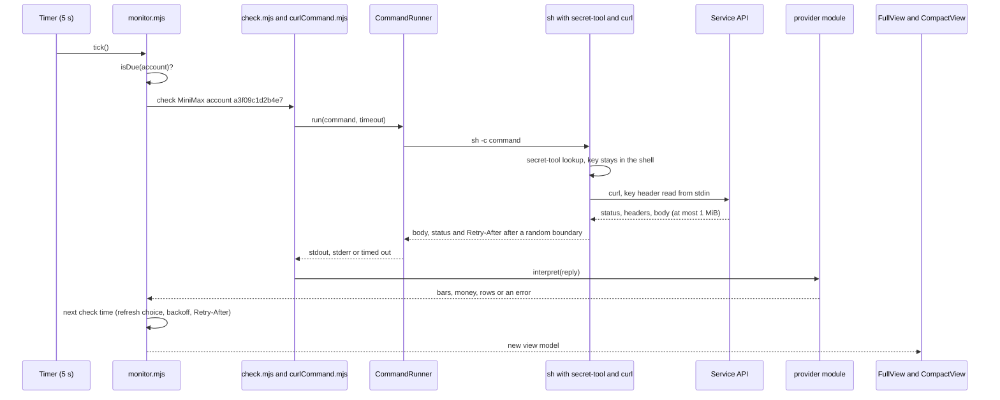

# AI Usage Widget

A KDE Plasma panel and desktop widget that shows AI limits, spend and balance for several services and accounts in one place.

[](LICENSE) [](https://kde.org/plasma-desktop/) [](https://curl.se/) [](https://www.qt.io/) [](#services-and-endpoints) [](tests/unit) [](tests/qml)

---

### What it is

The widget sits in the Plasma panel as a single icon. Click it to open a glassy popup with one card per account, laid out the same way for every service: the service name and the name or email you typed, then the main section with one bar each for the 5hr, daily, weekly and monthly limits (with their reset times where the service gives them) or the Balance and Spent this month for pay per use services, then the additional rows such as token counts, plan, billing mode, single models or members and top-up. Put it on the desktop and it shows the same cards there.

It exists because each AI service shows its usage on a different web page, and some only on a page you have to log in to. The widget is one program: it checks every account itself on a timer, keeps the latest values in memory and writes nothing to disk except its own settings. Nothing is turned on until you add an account. Keys are saved in KWallet from the widget's own settings, and the checks read them with `secret-tool` straight into `curl`, so a check never brings a key into the widget's memory. Claude, ChatGPT and JetBrains AI need no key: the widget reads, and never writes, the files their own apps keep on this computer. It skips symbolic links, and every read runs inside `timeout`.

---

### Quick start

The widget needs KDE Plasma and `curl` at least at the versions in the badges above, KWallet (the `kwallet` package, with `kwalletd6` running), `secret-tool` (the `libsecret` package), `gdbus` (the `glib2` package), `kreadconfig6` and `kwriteconfig6` (the `kconfig` package, part of every Plasma install), `base64`, `timeout` and GNU `find`. These exist only on Linux, so these steps have only a Unix-shell version.

1. Install the widget for your user:

```bash
kpackagetool6 -t Plasma/Applet -i ~/Projects/ai-usage-widget/package
```

2. Right-click the panel, choose Add Widgets, search for AI Usage and drag it to the panel or to the desktop.

3. Click the widget. With no account the popup shows only an Add account button. Press it, pick the service, type a name or email, paste the key (the "?" next to the key field names the key and where you create it) and press Save. Read the key safety section below first.

4. The top bar shows the name AI Usage at the left and two buttons at the right. Open the settings with the gear button to add, edit or delete accounts and to choose how often the widget refreshes. The refresh button next to it checks every account again.

To update an installed copy after a change:

```bash
kpackagetool6 -t Plasma/Applet -u ~/Projects/ai-usage-widget/package
```

Plasma keeps the old QML in memory until plasmashell restarts:

```bash
systemctl --user restart plasma-plasmashell
```

To remove the widget package:

```bash
kpackagetool6 -t Plasma/Applet -r com.github.lukk17.aiusage
```

---

### Settings

All settings live inside the popup. The widget adds no page to the Plasma configure dialog. The settings page has a Back button at the top left, and the gear button in the top bar still opens and closes it. Messages about settings actions show only on the settings page and clear when you leave it.

The account list and the refresh choice are saved in the widget's own file `~/.config/ai-usage-widgetrc` (in `$XDG_CONFIG_HOME` when that is set), not in the Plasma panel settings. They stay when a Global Theme layout, a panel reset or removing and adding the widget wipes the panel settings, and every copy of the widget (for example one in the panel and one on the desktop) shows the same accounts. Each copy reads the file every 30 seconds and before every change. The first start of this version copies the accounts from the old panel settings into the file once, and only when the file has no account list yet. The old copy is left as it is. Keys are never in this file, see [docs/adr/0007-accounts-in-the-own-settings-file.md](docs/adr/0007-accounts-in-the-own-settings-file.md).

1. Refresh every (shown on the account list, not in the Add or Edit form): 30 seconds (the default), 1, 5, 15, 30 or 60 minutes. Subscription limits follow this choice. Spend services (OpenAI API, Anthropic API, xAI API, OpenCode Zen, Requesty and Hugging Face) are asked at most every 5 minutes, also by the refresh button. The refresh button checks again at once, but never asks one account more than once per 30 seconds, except an account whose check never reached the service (no key, locked wallet), which is checked at once.
2. Add account: pick the service and type a name or email (1 to 100 characters, any text). A service with a key asks for the key, xAI also asks for the team ID. Claude asks for no key: the form lists the organizations found in the Claude desktop app file with their current percentages, and you type a name or email for each one you want. ChatGPT and JetBrains AI ask only for a name.
3. Edit changes the name or email, the team ID, or the key. An empty key field keeps the saved key. A new key is checked at once, a new name shows from the next check. The form keeps what you typed until Save succeeds or you press its Cancel, also when you close the settings or the popup.
4. Reorder the accounts by dragging the handle at the left of a row, or with the Move up and Move down buttons. The cards follow the same order, and the order is saved.
5. Delete asks once more, then removes the key from KWallet and the account from the list. When KWallet refuses, the account stays and the settings say why.
6. When KWallet is locked or does not answer, an Unlock KWallet button shows. Before each check the widget asks the Secret Service `SearchItems` with `gdbus`, which loads no secret and opens no prompt, whether the entry is locked. The button opens the wallet with `openAsync`, so KWallet asks for its password. While the widget waits, the popup says so and offers a Cancel that stops the wait at once. The widget closes the wallet again as soon as it opens, even after a long wait, and then checks again.

Each account gets a generated id such as `a3f09c1d2b4e7`. The key is saved in KWallet in the folder `ai-usage` as the entry `<service>.<id>`, for example `minimax.a3f09c1d2b4e7`, and the checks read it with `secret-tool lookup server 'ai-usage' user '<service>.<id>' type 'plaintext'`. The name or email you type never reaches a URL or a wallet entry name, and it reaches a command only inside the base64 encoded account list that `kwriteconfig6` saves, so no name can change the command. During Save the key passes once through plasmashell memory and over the session bus to `kwalletd6`, see [docs/adr/0005-keys-saved-through-the-kwallet-dbus-api.md](docs/adr/0005-keys-saved-through-the-kwallet-dbus-api.md).

---

### Key safety

KWallet and the Secret Service protect keys at rest and from other users, not from programs that run as you. Any program you run can ask it for every key stored here, so store only keys you accept that risk for.

1. Anthropic API and OpenAI API: create a separate Admin API key only for this widget, name it after the widget (for example `ai-usage-widget`), give it an expiration, rotate it, and delete it when you stop using the widget. Anthropic Console Admin API keys have no scopes: the [Admin API key docs](https://platform.claude.com/docs/en/manage-claude/admin-api-keys) say "every key carries full access to all endpoints that accept Admin API keys". OpenAI admin keys can be limited to the usage and cost permissions in the OpenAI Platform.
2. xAI API: a management key can manage the team, not only read billing. Create one only for the widget and delete it when you stop.
3. Hugging Face: use a fine-grained token with only the billing read permission (`user.billing.read`).
4. OpenCode Zen: create a separate service account only for the widget. The Budgets API needs All permissions, and All also lets the key read and change member budgets.
5. Requesty: the balance from `GET /org` needs a key with manage permission. `GET /apikey/self` works with any key. With a key that cannot read the balance, the Balance row stays on the card and says why.
6. OpenCode Go and MiniMax: when you store keys of other people here, every program that runs as you can read them. Store them only with the consent of their owners.
7. curl still honours the proxy and certificate variables of the plasmashell session: `HTTPS_PROXY`, `CURL_CA_BUNDLE`, `SSL_CERT_FILE` and `SSL_CERT_DIR`. Whoever can set them for your session can send the requests, with the key, through their own proxy or trust their own certificate. The check does turn off `SSLKEYLOGFILE`, shell tracing and export before the key is read.
8. During a check the key sits for a moment in the memory of `secret-tool`, a short shell and `curl`. The check starts with `ulimit -c 0`, so systemd-coredump should not store their dumps. Other programs that crash while they hold a key, including plasmashell during Save, are not covered. List stored dumps with `coredumpctl list`. To stop storing them, add a file under `/etc/systemd/coredump.conf.d/` with a `[Coredump]` section that sets `Storage=none`.

---

### Architecture

QML only binds and displays. Everything that parses, decides or formats lives in plain JavaScript modules under [package/contents/code](package/contents/code), which run unchanged in the Plasma QML engine and in Node for the unit tests. The modules under [package/contents/code/core](package/contents/code/core) never import a provider. [package/contents/ui/UsageController.qml](package/contents/ui/UsageController.qml) is the one place that puts providers, the transport, the wallet and the monitor together.



Every provider module implements one small interface: an id, a title, a kind (remote or local), whether it needs a key, the key help text and the fields an account needs. A remote provider adds an `auth` header style, `buildRequests(now, account)`, `interpret(results, now)` and an optional `classify(reply)`. A local provider adds a fixed read command, a size cap and `interpret(read, account, now)`. Every provider also names the shortest time between two checks (5 minutes for spend services). Providers return codes for limit periods, labels and errors, and [package/contents/code/core/formatter.mjs](package/contents/code/core/formatter.mjs) turns them into text. [package/contents/code/core/state.mjs](package/contents/code/core/state.mjs) keeps one immutable entry per account, and the popup keeps its cards in a list model synced by account id, so a refresh never rebuilds a card.

The path of one check for one account:



The reasons behind the main design choices are in the decision records under [docs/adr](docs/adr/README.md).

---

### Features

- A panel icon that opens the popup, with one line per account in its tooltip
- The same cards in the panel popup and on the desktop, on glassy translucent panels
- One layout for every card: the main numbers (Balance, Included credits left, Budget left, Spent this month), then the main bars labelled exactly 5hr, daily, weekly and monthly (the entry closest to its limit when a service has several), then the additional rows
- Nothing on by default: with no account the popup shows only an Add account button
- Add, edit and delete accounts inside the popup, with keys saved in KWallet and a "?" that names each key and where to create it
- One refresh choice for all accounts, 30 seconds by default
- An Unlock KWallet button when the wallet is locked
- Separate error states per account: cannot connect, key rejected, rate limited, unexpected answer, not available for this account, and no key
- A backoff that doubles from the refresh choice up to one hour and never comes before `Retry-After`. A lost connection retries without doubling, and a clock that moved back triggers a check at once
- Limits per answer: at most 1 MiB, 50 MiniMax models, 50 OpenCode Zen members and 64 characters for every text a service sends
- Several accounts per service, for example one OpenCode Go key per person
- Accounts kept in the widget's own settings file, so they survive a Global Theme layout or a panel reset and every copy of the widget shares them
- Accessible names for the panel button, the bars, the cards and the settings fields

---

### Services and endpoints

| Service | Source | Documented | Key |
|---|---|---|---|
| Claude | `${XDG_CONFIG_HOME:-~/.config}/Claude/plan-usage-history.json` of the Claude desktop app, read only. The newest sample per organization gives the 5hr and weekly percent. The file has no reset times, so the widget estimates them from the history ("Resets about 14:30", "Resets about Mon 14:30"), shows none when the app was closed at the start of the window, and turns a bar grey once its window has surely ended. | Not documented. Format given by the owner. | None |
| ChatGPT | The last rate limit line of the newest of the 20 newest `rollout-*.jsonl` files that has one, under `$CODEX_HOME/sessions`, or under `~/.codex/sessions` only when `$CODEX_HOME/sessions` does not exist, read only. With no session file the card says No Codex session found. | Not documented. Format taken from the open source Codex protocol code in [openai/codex](https://github.com/openai/codex). | None |
| OpenAI API | `GET https://api.openai.com/v1/organization/costs` and `GET https://api.openai.com/v1/organization/usage/completions`, daily buckets since the first day of the month in UTC | Official, [Usage and Costs API](https://platform.openai.com/docs/api-reference/usage) | Admin API key |
| Anthropic API | Team organizations with an Admin API key only. `GET https://api.anthropic.com/v1/organizations/cost_report` and `GET https://api.anthropic.com/v1/organizations/usage_report/messages`, daily buckets since the first day of the month in UTC | Official, [Usage and Cost API](https://platform.claude.com/docs/en/manage-claude/usage-cost-api) | Admin API key, or another key the page lists. An Individual organization gets a clear message instead. |
| xAI API | `GET https://management-api.x.ai/v1/billing/teams/{team ID}/prepaid/balance` for the balance and `GET https://management-api.x.ai/v1/billing/teams/{team ID}/postpaid/invoice/preview` for this month's spend (the sum of the invoice lines) | Official, [Management API](https://docs.x.ai/developers/management-api-guide) | Management key and team ID |
| OpenCode Go | `GET https://opencode.ai/zen/go/v1/usage` for the 5hr, weekly and monthly limits | Not documented. Taken from `packages/console/app/src/routes/zen/go/v1/usage.ts` in [anomalyco/opencode](https://github.com/anomalyco/opencode). | Go API key |
| OpenCode Zen | `GET https://opencode.ai/console/api/v1/budgets/members` for member spend and monthly budgets, shown as Budget left with the monthly bar for the member closest to the limit | Official, [Budgets API](https://opencode.ai/v2/docs/console/api/budgets/) | Service account key with All permissions |
| MiniMax | `GET https://api.minimax.io/v1/token_plan/remains`. The length of each model window (5hr or daily) comes from its start and end time. | Not in the public API docs. Taken from the open source [MiniMax CLI](https://github.com/MiniMax-AI/cli), error codes from the official [error code table](https://platform.minimax.io/docs/api-reference/errorcode.md). | Token Plan key that starts with `sk-cp-` |
| Requesty | `GET https://api-v2.requesty.ai/v1/manage/apikey/self` for monthly spend and limit, `GET https://api-v2.requesty.ai/v1/manage/org` for the balance | Official, [Management API](https://docs.requesty.ai/api-reference/management-apis.md) | Any Requesty key. The balance needs manage permission. |
| Hugging Face | `GET https://huggingface.co/api/whoami-v2` for the plan (PRO or free) and the billing mode, `GET https://huggingface.co/api/settings/billing/usage-by-inference-session` for this month's spend (the sum of `costCents`). PRO accounts also show Included credits left, 2.00 US dollars minus that spend and never below 0. Bought credits cannot be read | Listed in the [Hugging Face OpenAPI description](https://huggingface.co/.well-known/openapi.json) without full answer schemas, so the parser names any missing field. | Fine-grained token with billing read permission |
| JetBrains AI | The newest `QuotaManager2Impl - New quota state is: Available(` line across `~/.cache/JetBrains/*/log/idea.log`, read from the last 4 MiB of each log only. The tariff quota gives the monthly bar, and a top-up quota above zero adds a top-up row. Only the line time and the two quota parts are kept in the shell, so the license and quota ids never reach the widget. | Not documented. Format measured on the owner's computer. | None |

The MiniMax `*_usage_count` fields are ambiguous. The widget follows the MiniMax CLI: when the answer has a `*_remaining_percent`, that number decides, otherwise the count is read as the remaining count. A window that reads as fully used but has no plan details is shown, and it is not picked for a main bar while another entry for the same period has plan details.

---

### Terms of service notes

1. OpenCode Go allows one account per person. Add several Go accounts only for different people, each with their own key.
2. Claude and ChatGPT: the widget uses no login token, no browser cookie and no private endpoint. It only reads files that the Claude desktop app and Codex already keep on this computer.
3. The MiniMax and OpenCode Go endpoints and the Claude, Codex and JetBrains file formats are not public. They can change without notice, and the widget then shows an error for that account only.

---

### Comparison with alternatives

| | This widget | [CodexBar](https://github.com/steipete/CodexBar) | [ai-usage-widget by Muddyblack](https://github.com/Muddyblack/ai-usage-widget) | [CodexBar for KDE](https://github.com/psimaker/codexbar-plasmoid) |
|---|---|---|---|---|
| Platform | Plasma 6, at the version in the badge | macOS menu bar app, plus a Linux CLI | Plasma 6, also Hyprland, Windows and macOS hosts | Plasma 6 |
| How it gets data | The widget runs `curl` or reads a local file for each account itself | Provider CLIs, browser cookies, OAuth or API keys | A shared Python backend run through the executable engine | The CodexBar CLI |
| Extra programs needed | KWallet, `secret-tool`, `curl`, `timeout`, GNU `find` | The provider CLIs it reads | Python 3 | The CodexBar CLI |
| Where keys live | KWallet only, saved from the widget popup | Existing CLI logins, cookies or its own config | The widget configuration file, or the files of the tools it detects | Each provider tool or the CodexBar config |
| Writes to disk | Only its own settings | Not checked | Usage history under `~/.local/share/ai-usage-widget/` | Not checked |

Where this widget is weaker:

1. It covers fewer services than the alternatives above, which support dozens of providers each.
2. It has no usage history, no charts, no burn rate estimate and no notifications.
3. Claude numbers only move while the Claude desktop app runs, and ChatGPT numbers only while Codex runs.
4. Several sources are undocumented, see the services table.
5. It is not in the KDE Store and has no translations.

---

### Configuration

The settings live in `~/.config/ai-usage-widgetrc`, group `[General]`. The widget writes the file only after the first account is added (or copied from the old panel settings). No secret is ever stored there.

| Key | Type | Default | Meaning |
|---|---|---|---|
| `accounts` | String | not set | The accounts as a JSON list of `{ "id", "service", "name" }`, plus `teamId` for xAI and `org` for Claude. Written by the settings view. `[]` means every account was deleted. |
| `refreshSeconds` | Int | 30 | Seconds between checks: 30, 60, 300, 900, 1800 or 3600 |

The same two keys in the panel settings, with the schema [package/contents/config/main.xml](package/contents/config/main.xml), are only read to copy older settings into the file once. A unit test checks that this schema turns nothing on.

`service` is one of `claude`, `chatgpt`, `openai`, `anthropic`, `xai`, `opencodeGo`, `opencodeZen`, `minimax`, `requesty`, `huggingFace` and `jetbrains`. The widget opens no port.

---

### Tests

Every test runs in a container that shares nothing with the host: the source is copied into the image at build time, the container runs with `--network none`, all capabilities dropped, `no-new-privileges`, no devices, no volumes and no host D-Bus or KWallet, the results are copied out with `docker cp`, and the containers and images are removed at the end. The QML image installs its packages from a fixed Arch Linux Archive snapshot, set by `ARCHIVE_DATE` in [tests/docker/qml.Dockerfile](tests/docker/qml.Dockerfile). Each container is also limited to 512 processes, 2 GB of memory and 2 CPUs, and runs as an unused user id (10001). One script builds both images, runs both suites and cleans up:

```bash
bash tests/run-in-containers.sh
```

```powershell
bash tests/run-in-containers.sh
```

The results land in `test-results/` (or the folder given as the first argument): `node/unit.log` and `node/shellcheck.log`, then `qml/qmllint.log` and `qml/qml.log`. The script deletes only the `node` and `qml` folders inside it, and refuses a results folder that already exists outside the project and outside the temporary folder.

1. Node suite: unit tests for every provider, the curl command builder and parser, the local readers (which run the real read commands on fixture files in a throwaway home folder), the accounts and account actions, the settings file commands, the move from the panel settings and the queue of settings changes, the scheduler, the state, the formatter and the monitor, with the coverage gate (90 percent lines and functions, 75 percent branches), then ShellCheck on every shell script.
2. QML suite: qmllint on every view, then the widget code with the real `secret-tool`, `curl` and `kwalletd6`. It stores fake keys in a throwaway gnome-keyring Secret Service, adds, edits and deletes accounts through the popup settings (with `[KSecretD] Enabled=false` in a throwaway `kwalletrc`, so `kwalletd6` writes into that keyring), checks that a saved key is in no process argument list and no file, saves the accounts in a throwaway `ai-usage-widgetrc` with the real `kreadconfig6` and `kwriteconfig6` (the copy from the panel settings, two widgets sharing one file, a file locked with `[$i]`), runs a separate suite with a locked keyring for the `gdbus` locked check and the Unlock KWallet button, starts an HTTPS fixture server with a throwaway certificate on loopback addresses mapped to the service host names with `--add-host`, and ends by loading the installed widget in `plasmawindowed` and checking that with the default settings it reads no service file and writes no settings file.

The host names and addresses come from [tests/fixtures/scenarios.json](tests/fixtures/scenarios.json). The fixtures under [tests/fixtures](tests/fixtures) were not recorded from live calls. They were written from the official documentation and the open source code named in the services table, with every name, email, id and key replaced by an obvious placeholder.

---

### Documentation map

| Document | What it covers |
|---|---|
| [README.md](README.md) | Install, settings, key safety, architecture, services, terms, comparison, configuration and tests |
| [docs/adr/README.md](docs/adr/README.md) | Index of the decision records |
| [docs/adr/template.md](docs/adr/template.md) | Template for a new decision record |
| [docs/adr/0001-one-program-inside-the-widget.md](docs/adr/0001-one-program-inside-the-widget.md) | Why the widget is one program with no background service |
| [docs/adr/0002-curl-transport-through-the-executable-engine.md](docs/adr/0002-curl-transport-through-the-executable-engine.md) | Why requests run through `secret-tool` and `curl` in a shell pipeline |
| [docs/adr/0003-keys-in-the-secret-service.md](docs/adr/0003-keys-in-the-secret-service.md) | Why keys live only in the Secret Service |
| [docs/adr/0004-claude-through-the-status-line-only.md](docs/adr/0004-claude-through-the-status-line-only.md) | The earlier Claude status line design, superseded |
| [docs/adr/0005-keys-saved-through-the-kwallet-dbus-api.md](docs/adr/0005-keys-saved-through-the-kwallet-dbus-api.md) | Why keys are saved through the KWallet D-Bus API |
| [docs/adr/0006-settings-inside-the-widget-and-accounts-by-id.md](docs/adr/0006-settings-inside-the-widget-and-accounts-by-id.md) | Why settings live in the popup, accounts have generated ids and nothing is on by default |
| [docs/adr/0007-accounts-in-the-own-settings-file.md](docs/adr/0007-accounts-in-the-own-settings-file.md) | Why the accounts live in the widget's own settings file, shared by every copy, and how the old settings are copied |
| [LICENSE](LICENSE) | GNU General Public License version 3 |
| [package/contents/config/main.xml](package/contents/config/main.xml) | The old panel settings, read only to copy them into the settings file once |
| [tests/run-in-containers.sh](tests/run-in-containers.sh) | The one command that runs every test in isolated containers |
| [docs/kde-store-listing.md](docs/kde-store-listing.md) | Name options, description, changelog, tags and form fields for the KDE Store page |
| [docs/store-assets](docs/store-assets) | The KDE Store logo and gallery pictures, made with fake accounts only |

---

### License

GPL-3.0-or-later: the GNU General Public License version 3 or, at your option, any later version. See [LICENSE](LICENSE).
